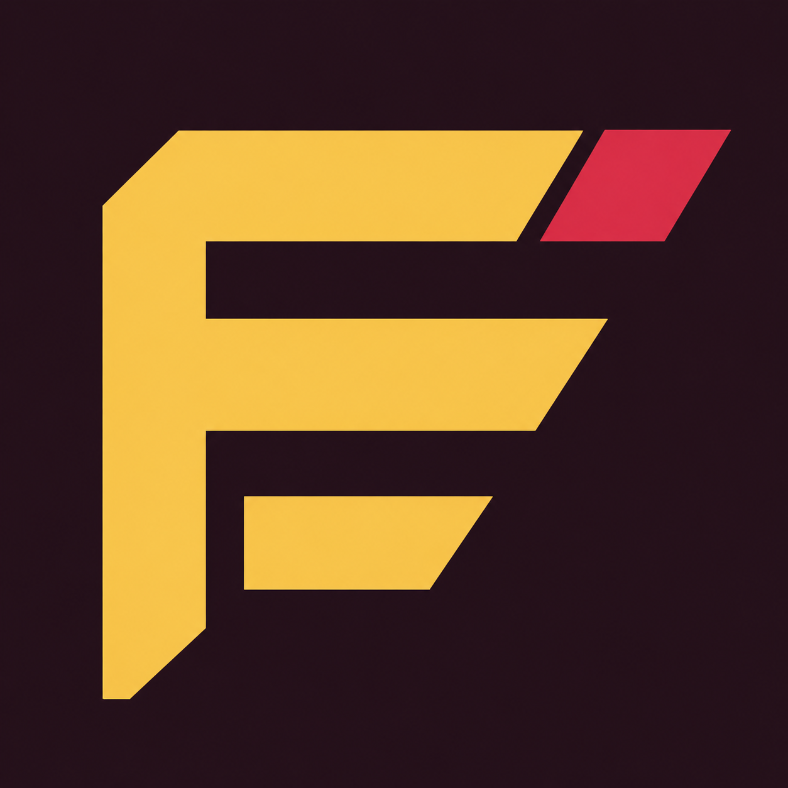

# Fillcraft

### A little character. A lot of progress.

**By [Dead Signal Interactive](https://deadsignal.studio)**

[Launch Fillcraft](https://raiinman.github.io/fillcraft/) · [Our studio](https://deadsignal.studio) · [GitHub](https://github.com/raiinman)

Make a progress bar with personality. Browse 48 ASCII, Unicode, wild and emoji designs, dial in your colors, or let Surprise me find something unexpected.

- **Make it yours.** Adjust length, spacing, labels, direction and progress with a live preview.
- **Collect the good ones.** Save directly from the searchable design library. Saved badges show what is already in your collection. Organize favorites into folders, rename them, and back them up.
- **Share the exact look.** Send a link with every design setting included.
- **Take your bar anywhere.** Copy or download plain text, colored HTML or SVG.
- **Settle into your space.** Blood Red & Gold by default, plus Autumn Purple, Ocean and Slate with matching logos. Brightness follows your desktop or browser, and your palette choice is remembered.

No account needed. Favorites live in your browser, so export a backup before clearing browser data or switching devices. Plain text does not retain colors. Marker spacing above zero inserts spaces between cells in text exports; set it to zero for a continuous bar. Emoji appearance depends on your device.

## Made by Dead Signal Interactive

Explore our work at [deadsignal.studio](https://deadsignal.studio), follow [@raiinman](https://github.com/raiinman), or [tell us what you would like next](https://github.com/raiinman/fillcraft/issues).

© 2026 Dead Signal Interactive. All rights reserved. Your exported progress bars are yours to use. The application itself is proprietary. See [LICENSE](LICENSE).
